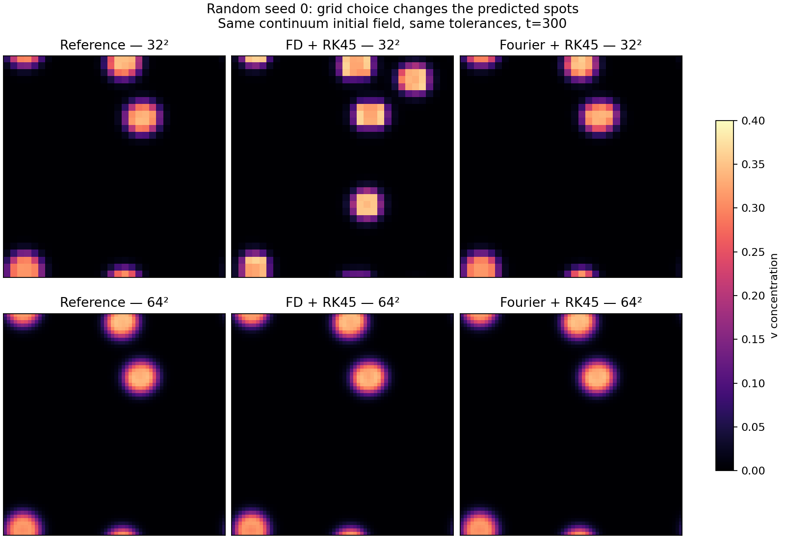
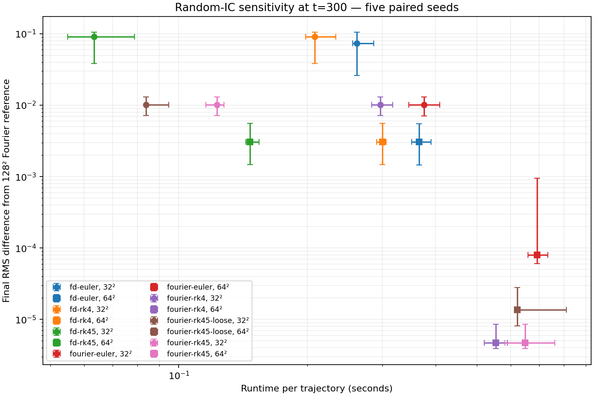
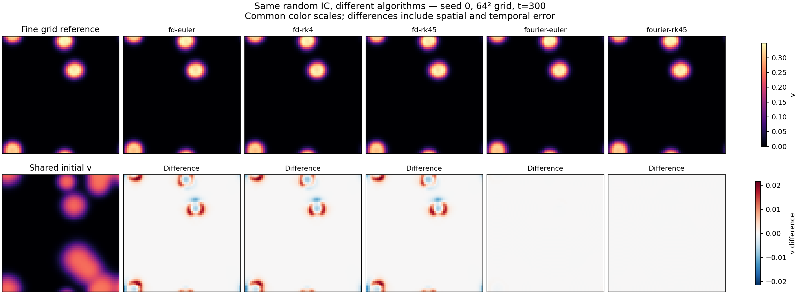

# Random initial-condition sensitivity study

Five paired random smooth periodic initial fields; domain [0,64]²; Du=0.2, Dv=0.1, F=0.035, k=0.065. Output times 0, 20, 100, 300. Each field is defined continuously by eight random spots and evaluated identically on nested grids.

Error is absolute RMS over u and v at t=300 against the same-seed 128² Fourier/RK45 reference (rtol=1e-10, atol=1e-13). Seed 0 reference checked against 256², rtol=1e-11: RMS difference 3.34e-11. This check was not repeated for other seeds. Fourier reaction products are not dealiased.

Runtime includes integration and retained snapshot copies, excludes initialization, disk output and plotting. One run per seed/strategy; medians and ranges below are across five seeds, not repeated timing trials. OPENBLAS_NUM_THREADS=1 and OMP_NUM_THREADS=1.

| Grid | Strategy | Median seconds | Median RMS | RMS range |
|---|---|---:|---:|---|
| 32² | fd-euler | 0.261 | 0.0738 | 0.026–0.105 |
| 32² | fd-rk4 | 0.208 | 0.0911 | 0.0385–0.105 |
| 32² | fd-rk45 | 0.063 | 0.0911 | 0.0385–0.105 |
| 32² | fourier-euler | 0.375 | 0.0101 | 0.00712–0.013 |
| 32² | fourier-rk4 | 0.297 | 0.0101 | 0.00713–0.013 |
| 32² | fourier-rk45-loose | 0.084 | 0.0101 | 0.00713–0.013 |
| 32² | fourier-rk45 | 0.123 | 0.0101 | 0.00713–0.013 |
| 64² | fd-euler | 0.366 | 0.00305 | 0.00146–0.00547 |
| 64² | fd-rk4 | 0.300 | 0.00305 | 0.00147–0.00557 |
| 64² | fd-rk45 | 0.147 | 0.00305 | 0.00147–0.00557 |
| 64² | fourier-euler | 0.692 | 8.03e-05 | 6.08e-05–0.000946 |
| 64² | fourier-rk4 | 0.553 | 4.73e-06 | 3.89e-06–8.6e-06 |
| 64² | fourier-rk45-loose | 0.622 | 1.37e-05 | 8.08e-06–2.8e-05 |
| 64² | fourier-rk45 | 0.648 | 4.73e-06 | 3.89e-06–8.6e-06 |

Euler dt=0.1; RK4 dt=0.5; RK45 rtol=1e-7, atol=1e-10 except loose rtol=1e-4, atol=1e-7.

## Findings

- Median final discrepancy: FD/RK45 0.0911 at 32², 0.00305 at 64²; Fourier/RK45 0.0101 at 32², 4.73e-6 at 64².
- On 64², Fourier/RK4 is about 645 times more accurate than FD/RK4 at about 1.85 times the runtime in this experiment.
- Changing time methods barely alters the FD error here. Spatial resolution dominates.
- Coarse-grid Euler sometimes has lower total error than RK4/RK45: cancellation between temporal and spatial errors is a plausible explanation, not evidence of superior temporal accuracy.
- Pairwise final RMS differences between independently drawn reference ICs: median 0.1713, range 0.1412–0.1783. This measures large random changes, not infinitesimal perturbation sensitivity or a Lyapunov exponent.
- At 64² the median spatial correlation of v is 0.99948 for FD/RK45; concentration errors remain despite visually similar spot locations.
- t=300 is a finite comparison horizon, not a verified steady state. This small ensemble and single parameter regime do not establish behavior for sharp ICs, other regimes, or arbitrarily long times.







## Reproduce

```bash
python -m pip install -e '.[plot,test]'
OPENBLAS_NUM_THREADS=1 OMP_NUM_THREADS=1 PYTHONPATH=. python experiments/random_ic_sensitivity.py
python experiments/plot_random_ic.py
```

The expensive 256² reference check took about 162 seconds on this CPU. Metrics and metadata are versioned here; numerical NPZ intermediates are generated locally. `grid_patterns.png` is a supplemental figure from the saved representative NPZ.
